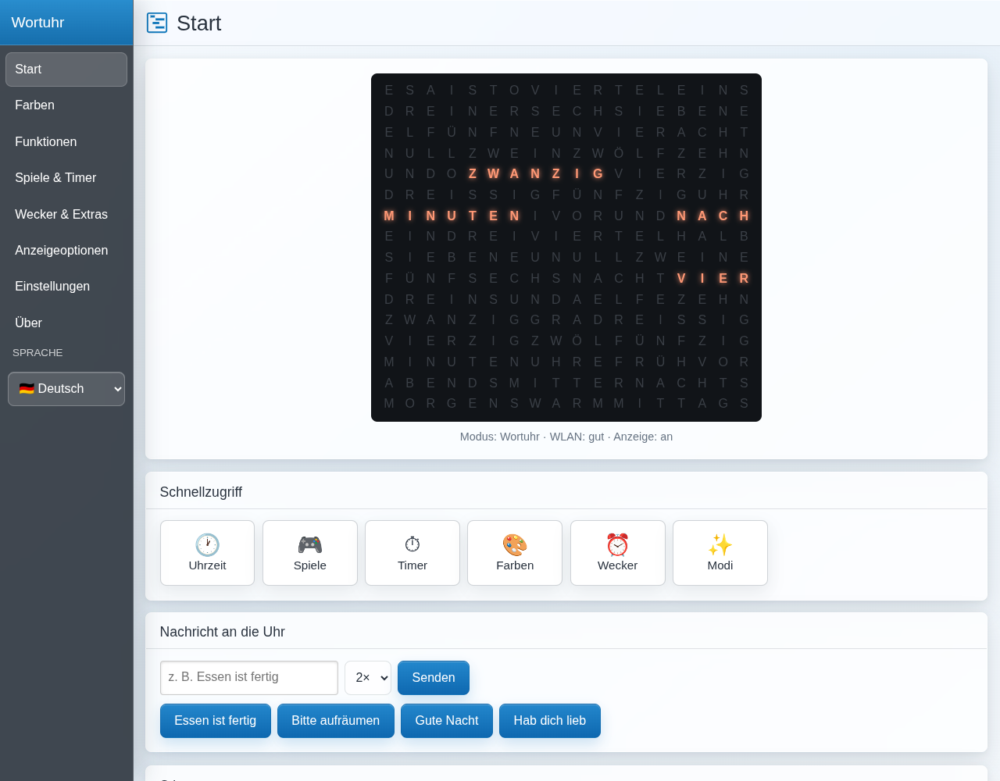

# Bedienung und Funktionen

Alles wird über die Weboberfläche der Uhr bedient: `http://<IP der Uhr>/`
oder `http://ESPWordclock.local`. Die IP steht z. B. in der Geräteliste des
Routers.

## Als App auf dem Handy

Die Weboberfläche im Handy-Browser öffnen und **„Zum Startbildschirm
hinzufügen"** wählen (Android: Menü ⋮, iPhone: Teilen-Symbol). Danach startet
sie wie eine App im Vollbild. Direkt auf eine Seite springen:

| Adresse | Seite |
| --- | --- |
| `http://<Uhr>/` | Start |
| `http://<Uhr>/#games` | Spiele & Timer |
| `http://<Uhr>/#extras` | Wecker & Extras |

Die Seite verbindet sich selbst neu, wenn man aus einer anderen App
zurückkommt. Zeigt sie nach einem Firmware-Update noch die alte Oberfläche:
die App ganz schließen (vom unteren Rand nach oben wischen und die App
wegwischen) und neu öffnen.

Auf dem Handy gibt es unten eine Leiste mit Start, Spiele, Farben, Wecker und
Mehr; das vollständige Menü öffnet sich über ☰ oben links.

## Start

* **Live-Vorschau**: die 16 × 18 Buchstaben der Uhr in den Farben, in denen
  sie gerade leuchten — auch während Spielen und Stimmungen.
* **Statuszeile**: aktueller Modus, WLAN-Qualität, Anzeige an/aus.
* **Schnellzugriff**: Uhrzeit, Spiele, Timer, Farben, Wecker, Modi.
* **Nachricht an die Uhr**: Text eingeben (bis 30 Zeichen), 1–5 Durchläufe
  wählen, *Senden*. Die Uhr zeigt ihn als Laufschrift und kehrt danach zur
  Uhrzeit zurück. Schnelltasten: „Essen ist fertig", „Bitte aufräumen",
  „Gute Nacht", „Hab dich lieb".
* **Stimmung**: Lavalampe, Kaminfeuer, Schneefall, Feuerwerk, Sternenhimmel,
  Regen. Bleibt an, bis *Uhrzeit* oder ein anderer Modus gewählt wird.

## Spiele & Timer

Oben den **Namen** eintragen (für die Bestenliste) und bei Spielen zu zweit
auswählen, ob dieses Handy **Spieler 1 (blau)** oder **Spieler 2 (orange)**
ist. Ein Spiel antippen — darunter erscheinen die passenden Bedienelemente,
Punkte und Hinweise. *Nochmal* startet neu, *Zurück zur Uhr* beendet.
Nach Spielende blinkt das letzte Bild, dann zeigt die Uhr die Punkte und
kehrt zur Uhrzeit zurück. Treffer und Spielende vibrieren auf dem Handy.

| Spiel | So geht's | Bedienung |
| --- | --- | --- |
| Tetris | Reihen füllen, sie verschwinden | ◀ ▶ schieben, ▲ drehen, ▼ schneller, *Fallen* |
| Snake | zum roten Apfel, nicht gegen Wand oder sich selbst | Pfeile |
| Flappy Vogel | durch die Lücken der grünen Röhren fliegen | *Flattern* |
| Breakout | Ball mit dem Schläger halten, Steine zerschießen | ◀ ▶, *Start* |
| Weltraum-Invasion | Aliens abschießen, Bomben ausweichen | ◀ ▶, *Feuer* |
| Frosch über die Straße | Frosch heil nach oben bringen | Pfeile |
| Farben merken | Farbfolge der Uhr nachdrücken, jede Runde eine mehr | vier Farbtasten |
| Pong zu zweit | Ball zurückspielen, erster bei 5 Punkten gewinnt | ▲ ▼, jeder am eigenen Handy |
| Pong gegen die Uhr | wie oben, die Uhr spielt rechts | ▲ ▼ |
| Vier gewinnt zu zweit | vier in einer Reihe, Rot beginnt | ◀ ▶ Spalte, *Fallen* |
| Vier gewinnt gegen die Uhr | du bist Rot, die Uhr Gelb | ◀ ▶, *Fallen* |
| Reaktionsduell | wer drückt zuerst, wenn es grün wird? Zu früh = Punkt für den anderen | *JETZT!*, jeder am eigenen Handy |
| Galgenmännchen | Wort raten; richtige Buchstaben leuchten grün auf der Uhr, falsche rot | Buchstabentastatur |
| Uhrzeit-Quiz | Uhrzeit in Worten lesen und an der Analoguhr einstellen, 10 Fragen | Regler Stunde/Minute, *Prüfen* |
| Wörter finden | das gesuchte Wort in der Vorschau Buchstabe für Buchstabe antippen, 10 Wörter | Vorschau antippen |
| Kopfrechnen | Aufgabe auf der Uhr lösen (+ − × :), 10 Aufgaben | Zifferntasten, *OK* |
| Malbrett | Farbe wählen und in der Vorschau malen, auch mit dem Finger ziehen; das Bild bleibt erhalten, wenn man später zurückkommt | 40 Farben (kräftig, pastell, dunkel, Weiß- und Grautöne) und Radierer, Regler *Helligkeit*, *Alles füllen*, *Löschen* |

Am PC: Pfeiltasten, Leertaste oder Enter (Aktion), P (Pause); beim
Galgenmännchen die Buchstabentasten, bei *Farben merken* die Tasten 1–4.

**Bestenliste**: Einzelspiele merken sich die fünf besten Ergebnisse mit
Namen, auch über einen Neustart hinweg. Ein neuer Rekord wird in der App
angezeigt und die Punkte leuchten auf der Uhr grün.

**Countdown & Stoppuhr**: Minuten und Sekunden eintragen, *Countdown
starten* (bis 99:59) oder *Stoppuhr starten*; *Pause / Weiter*, *Beenden*.
Am Ende des Countdowns blinkt 00:00 für 15 Sekunden, das Handy vibriert.

## Wecker & Extras

**Wecker** — vier Weckzeiten. Je Wecker: an/aus, Uhrzeit, Wochentage und
der Effekt, mit dem geweckt wird:

| Effekt | Ablauf |
| --- | --- |
| Sonnenaufgang | wird über 3 Minuten von dunkelrot zu warmweiß heller |
| Blinken | rot/weiß blinkend |
| Feuerwerk, Lavalampe, Kaminfeuer, Sternenhimmel | die Stimmungsanimation |

Die Uhr hat keinen Lautsprecher und weckt nur mit Licht. Ist die Anzeige
gerade aus (Taster, Nachtschaltung), schaltet der Wecker sie ein. Beenden:
**Taster am Controller** drücken, in der App *Wecker aus* (erscheint oben,
solange er klingelt) oder automatisch nach 5 Minuten. *Speichern* nicht
vergessen.

**Lern-Farben** — die Stundenwörter erscheinen in einer zweiten Farbe, so
sieht man sofort, welcher Teil des Satzes die Stunde ist. Bei weißer
Vordergrundfarbe werden die Stunden orange.

**Feuerwerk an Silvester** — am 1. Januar um 0:00 Uhr 90 Sekunden Feuerwerk.

**Hinweise (Home Assistant)** — zeigt, wie ein Hinweis aus Home Assistant
aussieht: Symbol wählen, Text eingeben, *Hinweis testen*. Einrichtung siehe
[Home-Assistant.md](Home-Assistant.md).

## Anzeigeoptionen

**WordClock24h → Einblendungen** (bis zu acht, z. B. alle 15 Minuten):

| Art | Anzeige |
| --- | --- |
| Symbol | eines der Symbole (Herz, Tannenbaum, Waschmaschine …) |
| Wettersymbol, Temperatur, Datum, Laufschrift | wie in der Original-WordClock24h |
| **Tage bis …** | `NOCH 12 TAGE: FERIEN`, am Vortag `MORGEN: FERIEN`, am Tag `HEUTE: FERIEN`. Zieldatum als TT.MM, Text dahinter frei |
| **Mondphase** | die heutige Mondphase als Symbol |

**Digitaluhr** (für den Modus *Funktionen → Digitaluhr*): Doppelpunkt
blinkend, dauerhaft oder aus; 12-/24-Stunden-Anzeige; führende Null
(07:30 oder 7:30); Sekundenbalken zwischen den Ziffernzeilen; Ziffern
zentriert statt versetzt.

**Boot**: was beim Einschalten passiert (Aufblitzen, LED-Durchlauf,
WLAN-Symbol, IP-Adresse) und die **Geschwindigkeit** 1 (langsam) bis
10 (schnell); 6 entspricht dem bisherigen Tempo.

## Einstellungen

**Darstellung**:
* **Farbschema** Automatisch / Hell / Dunkel.
* **Experteneinstellungen anzeigen** — blendet LED-Typ, Weißtyp,
  Hardware-Pins, Zeitserver, Hostname, Frontlayout, Minuten-LEDs, Debug und
  den Menüpunkt *Smart Home* ein. Ohne den Schalter bleibt die Oberfläche
  übersichtlich.

Beide Einstellungen merkt sich der Browser, sie gelten also pro Gerät.

## Was nach einem Neustart passiert

Spiele, Timer, Nachrichten, Stimmungen und der Wecker sind vorübergehend:
Nach einem Neustart zeigt die Uhr wieder die Uhrzeit. Alle Einstellungen
(Farben, Wecker, Digitaluhr, Einblendungen …) und die Bestenlisten bleiben
erhalten.
