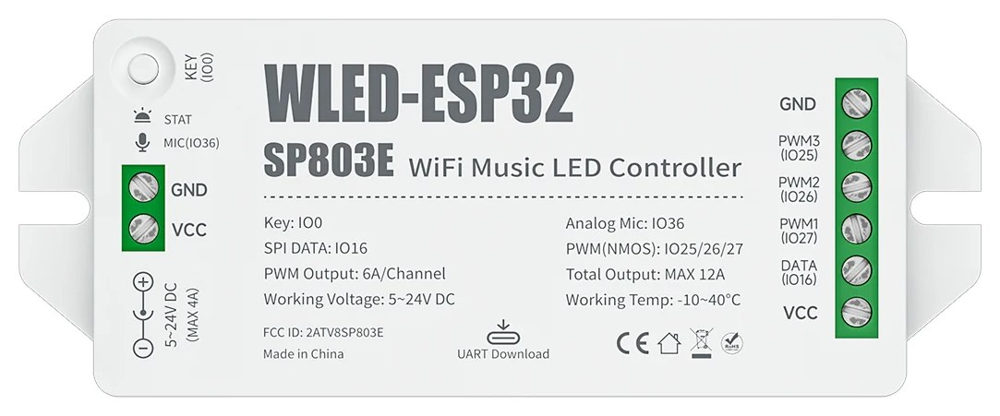

# Umbau einer Original-WordClock24h auf den SP803E

Diese Anleitung beschreibt, wie eine fertig gebaute
[WordClock24h](https://www.mikrocontroller.net/articles/WordClock_mit_WS2812)
mit **Nucleo-F401RE/F411RE** und der Trägerplatine **„Shield für
nucleo-Board" V2.1a** (Volker R., pcl86) auf den BTF-LIGHTING **SP803E**
umgerüstet wird — ohne Löten, das Nucleo lässt sich jederzeit wieder
einstecken.

> **Sicherheit:** Das Netzteil der Uhr (z. B. Mean Well MPM-20-5) ist ein
> Printnetzteil mit offenen 230-V-Anschlüssen. Vor jedem Eingriff den
> Netzstecker ziehen. Netzseitige Verbindungen gehören in Klemmen
> (z. B. Wago 221) mit Zugentlastung, nicht nur unter Isolierband.

## Was die Trägerplatine macht

Laut [Schaltplan](https://www.mikrocontroller.net/articles/WordClock_mit_WS2812)
der V2.1a:

| Signal | Weg auf der Trägerplatine | Nach dem Umbau |
| --- | --- | --- |
| 5 V Eingang | Stecker **St-08 „VCC +"** | bleibt, vom Netzteil über den Verpolungsschutz |
| LED-Strom | über **IRF9310** (Q2), geschaltet von **PC8** → R8 82 Ω → **BS170** (Q1), R7 100 kΩ nach GND | PC8 muss dauerhaft HIGH sein, sonst bleiben die LEDs dunkel |
| LED-Strom zu den Streifen | Flachbandstecker **St-04 „Strom WS2812"**, obere Reihe +5 V, untere GND | bleibt |
| WS2812-Daten | **PC6** → R1 220 Ω → Stecker **St-03 „WS2812 Signal"** | vom SP803E an PC6 einspeisen |
| 3,3 V | eigener Regler LM3940 auf der Platine | bleibt (versorgt ESP-01 usw.) |
| DCF77, DS18x20, LDR, RTC, ESP8266, TSOP | Module an den übrigen Steckern | ohne Funktion, können stecken bleiben |

Das **blaue Kabel** auf der Rückseite der V2.1a ist die im Artikel
beschriebene Korrektur für die LED-Abschaltung — nicht entfernen.

Die kleine Lochrasterplatine mit **IRF3707Z** und Widerstand in der
Zuleitung ist ein **Verpolungsschutz** (N-MOSFET in der Masseleitung). Er
verliert bei 4 A nur etwa 0,05 V und bleibt drin.

## Variante A: Trägerplatine weiterverwenden (empfohlen)

### Material

* SP803E mit dieser Firmware (geflasht über USB-C, siehe README)
* Steckbrückenkabel (Dupont) Stecker–Stecker und Stecker–Buchse
* ein Widerstand **220 Ω – 22 kΩ** (z. B. 1 kΩ)
* Multimeter

### Verdrahtung



```
Verpolungsschutz Ausgang +5 V ──► SP803E links VCC
Verpolungsschutz Ausgang GND  ──► SP803E links GND

SP803E rechts DATA (IO16) ─────► Trägerplatine PC6  (CN10 Pin 4)
SP803E rechts GND ─────────────► Trägerplatine GND  (CN10 Pin 9)
SP803E rechts VCC ──[ 1 kΩ ]──► Trägerplatine PC8  (CN10 Pin 2)
```

* Der SP803E bekommt seinen Strom direkt vom **Ausgang** des
  Verpolungsschutzes (die Seite zur Trägerplatine), nicht von den dünnen
  Steckbrücken.
* Die rechte VCC-Klemme des SP803E führt dieselbe Spannung wie die linke.
* Die GND-Brücke zur Trägerplatine gehört dazu: Das Datensignal braucht
  seine Masse direkt daneben, über den Umweg der Stromleitung verschiebt
  sich der Bezugspunkt, sobald Strom fließt. Pin 1 von CN10 liegt an dem
  Ende, an dem PC8 und PC6 stecken; GND ist die innere Reihe, 5. Buchse
  von dort. Vorher messen (0 Ω zum Minus des Netzteils), ein falscher Pin
  zieht PC6 oder PC8 auf Masse und die Matrix bleibt dunkel.
* Die Widerstandsbeine isolieren (Schrumpfschlauch/Isolierband): VCC liegt
  direkt neben DATA.

### Buchsen finden

Das Nucleo steckt mit seinen Morpho-Stiftleisten in zwei doppelreihigen
Buchsenleisten der Trägerplatine: **CN7** und **CN10**. Pin 1 liegt an dem
Ende, an dem beim Nucleo der (meist abgesägte) ST-Link war. Gerade
Pinnummern liegen bei CN10 in der äußeren Reihe.

| Signal | CN10 Pin | Position |
| --- | --- | --- |
| PC8 | 2 | äußere Reihe, 1. von oben |
| PC6 | 4 | äußere Reihe, 2. von oben |
| GND | 9 / 20 | innere Reihe 5. / äußere Reihe 10. von oben |
| E5V (5 V) | CN7 Pin 6 | innere Reihe, 3. von oben |

Weil die Lage der Reihen je nach Blickrichtung leicht verwechselt wird,
lassen sich die Buchsen eindeutig **messen** (Netzstecker gezogen, Nucleo
abgezogen):

| Messung | Bereich | Erwartet | Warum |
| --- | --- | --- | --- |
| PC6 ↔ Signal-Pin von St-03 | Ω 2000 | ≈ 220 | R1 liegt dazwischen |
| PC8 ↔ GND | Ω 200k | ≈ 100 (kΩ) | R8 + R7 nach GND |
| GND-Buchse ↔ Minus am Netzteil | Ω 200 | ≈ 0 | Masse |
| E5V ↔ GND, Netzstecker drin | V⎓ 20 | ≈ 5 V | Versorgung des Nucleo |

Die Messspitzen passen nicht in die Buchsen: ein Stecker–Stecker-Kabel
hineinstecken und am anderen Ende messen.

### Prüfen nach dem Anschließen

1. Netzstecker rein. Am SP803E leuchten zwei grüne LEDs.
2. Am Lötpunkt „+" des Flachbandsteckers „Strom WS2812" müssen ≈ 5 V
   anliegen — sonst kommt PC8 nicht an (Widerstand/Buchse prüfen).
3. Die Matrix zeigt die Uhrzeit. Die Status-LED unter der Matrix bleibt aus.

## Variante B: ohne Trägerplatine

* Flachbandkabel „Strom WS2812" (16-polig): ungerade Adern (Reihe 1, rot
  markierte Ader = 1) sind +5 V, gerade Adern GND. Über einen
  IDC-Schraubklemmen-Adapter oder einen Wannenstecker auf Lochraster
  zusammenfassen und mit mindestens 0,5 mm² an *SP803E rechts VCC/GND*.
* Kabel „WS2812 Signal": Signalader an *DATA*, GND-Ader an *GND*. Den
  220-Ω-Widerstand R1 der Trägerplatine kann man in die Datenleitung
  übernehmen.
* Vorher mit dem Multimeter prüfen, welche Reihe GND ist — vertauscht
  zerstört das die LEDs.
* Die LED-Abschaltung (IRF9310) entfällt; die LEDs hängen dauerhaft an 5 V
  (Ruhestrom etwa 1–2 W).

## Netzteil

Das Original-Netzteil **Mean Well MPM-20-5** (5 V / 4 A) reicht: Die Uhr
braucht bei 60 % Helligkeit etwa 1 A, bei voller Helligkeit in Weiß etwa
3,5 A. Die Hohlbuchse des SP803E ist ebenfalls für 4 A ausgelegt, die
Schraubklemmen sind aber die sicherere Verbindung.

## Besonderheiten der Original-Verdrahtung

* **Status-LED:** Die Datenleitung läuft zuerst durch eine einzelne LED
  unten in der Mitte und erst dann zur Matrix (oben links, Zeilen als
  Serpentine). Die Firmware berücksichtigt das mit `STATUS_LED_COUNT 1` in
  `include/Config.h`. Leuchtet nach dem Umbau **nur diese eine LED**, fehlt
  der LED-Strom der Matrix (PC8, siehe oben). Bei einer Kette ohne
  Status-LED den Wert auf 0 setzen.
* **3,3-V-Datenpegel:** Der ESP32 sendet mit 3,3 V, wie vorher das STM32.
  WS2812 erkennen eine „1“ sicher erst ab etwa 3,5 V. Das reicht oft, aber
  knapp: Die Anzeige friert dann plötzlich ein, nur die ersten Buchstaben
  („E“, „S“) leuchten in falschen Farben, Rütteln oder Berühren ändert das
  Bild. Bei der V2.1a war das schon mit dem Nucleo so (die Shields ab V3
  ziehen das Signal über einen Widerstand auf 5 V, was nur mit den
  5-V-festen STM32-Pins geht). Abhilfe am ESP32: ein Pegelwandler
  **74AHCT125** (siehe unten). Die Firmware sendet das Bild außerdem jede
  Sekunde neu, damit ein gestörtes Bild nicht stehen bleibt, und treibt die
  LEDs über I2S mit DMA, damit WLAN-Interrupts die Übertragung nicht
  stören.

### Pegelwandler 74AHCT125

Der SN74AHCT125N (DIP-14) hebt das 3,3-V-Signal auf 5 V. Er passt auf ein
Mini-Steckbrett, Dupont-Kabel genügen.

```
             ┌───u───┐
 GND ── 1 OE │1    14│ VCC ── +5 V
 DATA ─ 1A   │2    13│ 4OE ── +5 V (aus)
 PC6 ── 1Y   │3    12│ 4A  ── GND
 +5 V ─ 2OE  │4    11│ 4Y     frei
 GND ── 2A   │5    10│ 3OE ── +5 V (aus)
        2Y   │6     9│ 3A  ── GND
 GND ── GND  │7     8│ 3Y     frei
             └───────┘
```

* `DATA` = SP803E rechts DATA (IO16), `PC6` = Trägerplatine CN10 Pin 4
  (dort folgt R1 220 Ω zur LED-Kette).
* +5 V und GND vom Ausgang des Verpolungsschutzes oder SP803E rechts
  VCC/GND. GND des Chips und des SP803E müssen verbunden sein.
* Die Kerbe des Chips zeigt zu Pin 1/14. Ein 100-nF-Kondensator zwischen
  Pin 14 und 7 schadet nicht.
* **Nicht mehr nutzbar:** DCF77, Lichtsensor (LDR), DS18x20, RTC-Modul,
  IR-Empfänger — der SP803E hat dafür keine freien Anschlüsse. Die Uhrzeit
  kommt per NTP aus dem Internet.

## Fehlersuche

| Symptom | Ursache |
| --- | --- |
| STAT-LED am SP803E dunkel | normal, die Firmware nutzt sie nicht. Läuft der ESP32, ist sein WLAN `Connect_to_Wordclock` bzw. die Weboberfläche erreichbar |
| SP803E ohne Strom | Dupont-Stifte erreichen die Klemmfeder nicht: Kabel abisolieren statt Stecker in die Klemme |
| Matrix dunkel, nur Status-LED an | PC8 nicht HIGH: Widerstand, Buchse PC8 und 5 V am Widerstand prüfen |
| Matrix komplett dunkel | Daten nicht an PC6 (220-Ω-Messung) oder Kabel in einer PWM- statt der DATA-Klemme |
| Buchstaben verschoben | `STATUS_LED_COUNT`, Serpentine und Spiegelung in *Einstellungen* prüfen |
| Einzelne Buchstaben blitzen falsch auf | siehe 3,3-V-Datenpegel |
| Bild friert ein, nur E/S/D leuchten bunt, Rütteln ändert das Bild | Datenpegel zu knapp: GND-Brücke prüfen, Pegelwandler 74AHCT125 einbauen |
| Matrix nach dem Stecken der GND-Brücke ganz dunkel | GND-Kabel steckt auf PC6 oder PC8 statt auf GND |
| Spiele laufen seitenverkehrt | ältere Firmware, aktuelle Version flashen |
